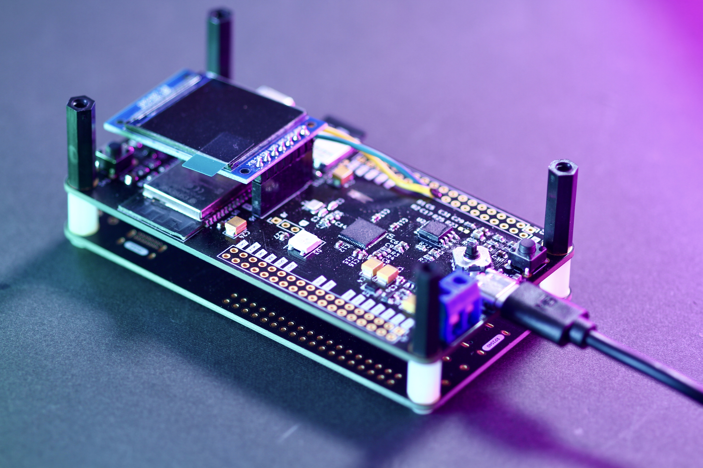

# Watch the video

<div align="center">
  <div align="center">
  <a href="https://youtu.be/p60-jE2-4uw" target="_blank" rel="noopener noreferrer">
    
  </a>
</div>
</div>


# license

* will be updated soon. (feel free to tinker for you personal use)

# rp2040-esp32-experiment-board

Experiment board using RP2040 and ESP32
The purpose of this board is to confirm or practice the following things:

* UART communication between RP2040 and ESP32 makes it behaves like Raspberry Pi Pico W
* test joystick with RP2040
* soldering different USB-C type receptacles
* test lipo battery charging chip
* test SD card with RP2040


The PCB is designed with KiCad, manufactured by JLCPCB.

# software

The firmware is in [`software/`](./software). Each chip has its own [PlatformIO](https://platformio.org/) project, with one environment per program.

| Folder | Chip | Environments |
|---|---|---|
| `software/esp32` | ESP32 | `st7789_receiver` (default), `lgfx_user_setting`, `lgfx_moving_circles`, `lgfx_moving_icons`, `uart_link_test` |
| `software/rp2040` | RP2040 ([Arduino-Pico](https://github.com/earlephilhower/arduino-pico) core) | `uart_sender` (default), `sd_card_logger`, `sd_card_test`, `uart_link_test`, `gp8_toggle_test` |

Build and upload, for example:

```
cd software/esp32
pio run -e st7789_receiver -t upload
```

For the first RP2040 upload, hold BOOTSEL while plugging in the USB cable.

In the demo, pressing the joystick runs `uart_sender` on the RP2040, which sends `0`–`4` over UART. `st7789_receiver` on the ESP32 then shows the digit on the display.

## UART pins

In the schematic, RP2040 GP8 (TX) connects to ESP32 IO16 (RX), and ESP32 IO17 (TX) connects to RP2040 GP9 (RX).
On my board, the GP8 → IO16 line does not reach the ESP32, probably because of a soldering problem. So the current code sends from the RP2040 to the ESP32 over GP9 → IO17 instead (with `SerialPIO` on the RP2040), and only in that direction.
If both lines work on your board, you can switch back to the hardware UART (GP8 / IO16). Run `uart_link_test` on both chips to check each direction.

# KiCad render (LED for RP2040 added, GP25)


# schematic


# the first version


